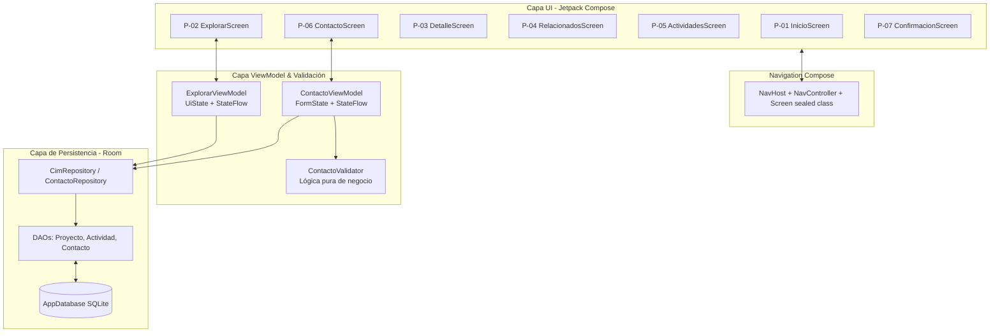

# Plan Detallado de Implementación · CIM UC

---

## 1. Objetivo General

Desarrollar una aplicación móvil nativa funcional para el **Centro UC de Innovación en Madera (CIM UC)** que permita explorar proyectos, capacidades I+D, integrantes, publicaciones y actividades, integrando:
* Navegación declarativa multipantalla con **Navigation Compose**.
* Interfaz y formularios con validación visual reactiva en **Jetpack Compose**.
* Arquitectura **MVVM** con flujo unidireccional de datos y desacoplamiento de lógica de negocio.
* Persistencia local relacional con **Room (SQLite + Flow)** y precarga de catálogo ficticio.
* Animaciones y transiciones de interfaz orientadas a retroalimentación y usabilidad.
* Integración de capacidades y recursos del dispositivo (`Intent.ACTION_SEND` e `Intent.ACTION_SENDTO`) sin requerir permisos peligrosos innecesarios.

---

## 2. Resumen Técnico

| Módulo / Capa | Decisión Técnica | Propósito / Alcance |
| :--- | :--- | :--- |
| **Interfaz (UI)** | Jetpack Compose (Material 3) | 7 pantallas operativas (P-01 a P-07), layouts adaptables (`Scaffold`, `LazyColumn`, `Card`), componentes reutilizables y consistencia táctil/visual. |
| **Navegación** | Navigation Compose | Grafo de rutas centralizado (`Screen` sealed class), `NavHost`, `NavController` y back stack gestionado de forma predecible. |
| **Formularios & Validación** | Campos controlados + Validador desacoplado | `OutlinedTextField` conectados a `StateFlow`, `ContactoValidator` puro sin dependencias de UI, retención de datos tras error y feedback visual por campo. |
| **Arquitectura** | MVVM Unidireccional | Eventos de UI $\rightarrow$ ViewModel $\rightarrow$ Repositorio $\rightarrow$ `StateFlow` / `Flow` $\rightarrow$ UI reactiva. |
| **Persistencia Local** | Room (SQLite) | Entidades relacionales, DAOs reactivos (`Flow<List<T>>`), base de datos SQLite pre-poblada con datos ficticios y persistencia de solicitudes de contacto. |
| **Animaciones** | Compose Transitions & Animations | Transiciones laterales y desvanecimiento en cambio de destinos (`NavHost`), feedback interactivo con `AnimatedVisibility` y cambios de lista suaves. |
| **Recursos Nativos** | Intents del Sistema Operativo | Compartir ficha de proyecto (`ACTION_SEND`) y enlace directo a cliente de correo (`ACTION_SENDTO` con `mailto:`). |

---

## 3. Estructura de Paquetes Propuesta

Organización modular bajo el estándar de nombres del proyecto:

```text
cl.duocuc.cimuc/
├── MainActivity.kt
├── data/
│   ├── local/
│   │   ├── AppDatabase.kt
│   │   ├── dao/
│   │   │   ├── ProyectoDao.kt
│   │   │   ├── IntegranteDao.kt
│   │   │   ├── ActividadDao.kt
│   │   │   ├── SolicitudContactoDao.kt
│   │   │   └── ...
│   │   └── entity/
│   │       ├── ProyectoEntity.kt
│   │       ├── SolicitudContactoEntity.kt
│   │       └── ...
│   └── repository/
│       ├── CimRepository.kt
│       └── ContactoRepository.kt
├── domain/
│   └── model/
│       ├── Proyecto.kt
│       ├── Integrante.kt
│       ├── Actividad.kt
│       └── SolicitudContacto.kt
├── navigation/
│   ├── Screen.kt
│   └── AppNavigation.kt
├── ui/
│   ├── components/
│   │   ├── BottomNavBar.kt
│   │   ├── TopAppBarCommon.kt
│   │   ├── ProyectoCard.kt
│   │   └── FilterChipGroup.kt
│   ├── screens/
│   │   ├── inicio/InicioScreen.kt
│   │   ├── explorar/ExplorarScreen.kt
│   │   ├── detalle/DetalleScreen.kt
│   │   ├── relacionados/RelacionadosScreen.kt
│   │   ├── actividades/ActividadesScreen.kt
│   │   ├── contacto/ContactoScreen.kt
│   │   └── confirmacion/ConfirmacionScreen.kt
│   └── theme/
│       ├── Color.kt
│       ├── Theme.kt
│       └── Type.kt
├── viewmodel/
│   ├── ExplorarViewModel.kt
│   ├── ContactoViewModel.kt
│   └── DetalleViewModel.kt
└── validation/
    ├── ValidationResult.kt
    └── ContactoValidator.kt
```

---

## 4. Plan de Acción por Módulos de Trabajo



---

### 4.1. Módulo: Interfaz de Usuario y Navegación Declarativa

| ID | Tarea | Detalle Técnico de Implementación | Criterio de Aceptación |
| :--- | :--- | :--- | :--- |
| **N1** | Configurar rutas y NavHost | Centralizar rutas en `Screen(val route: String)` e implementar `NavHost` conectando P-01 a P-07 en `AppNavigation.kt`. | Navegación declarativa funcional y desacoplada entre pantallas. |
| **N2** | Barra de navegación inferior | Implementar `NavigationBar` con `NavigationBarItem` visible solo en destinos primarios (P-01, P-02 y P-05). | Se oculta/muestra automáticamente según el destino activo. |
| **N3** | Barra superior con retroceso y retención | `TopAppBar` con `IconButton` (`popBackStack()`) para P-03, P-04 y P-06. Al regresar a P-02, el estado de búsqueda y filtros se conserva intacto. | Navegación hacia atrás predecible sin pérdida del estado de búsqueda. |
| **N4** | Construcción de las 7 pantallas | Desarrollar composables dedicados (`@Composable`) para P-01 a P-07 siguiendo `docs/06-mockups.md` con `Scaffold`, `LazyColumn`, `Card`, etc. | Las 7 pantallas operativas con componentes declarativos estándar. |
| **N5** | Consistencia visual y adaptabilidad | Definir `MaterialTheme` con paleta institucional, tipografía consistente, espaciados múltiplos de 8dp, targets táctiles $\ge 48\text{dp}$ y textos $\ge 14\text{sp}$. | Cumple con estándares de diseño y accesibilidad en pantalla vertical. |

---

### 4.2. Módulo: Formularios y Captura de Datos

| ID | Tarea | Detalle Técnico de Implementación | Criterio de Aceptación |
| :--- | :--- | :--- | :--- |
| **F1** | Layout de contacto en Compose (P-06) | `OutlinedTextField` para nombre, correo, organización, motivo y mensaje. Campo "Contenido referido" de solo lectura (`readOnly = true`) y botón de envío. | Interfaz fiel al diseño de mockups para P-06. |
| **F2** | Validación visual en tiempo real | Configurar `isError = error != null` y `supportingText = { Text(error) }` en cada campo de entrada. | Errores específicos visibles debajo del campo correspondiente. |
| **F3** | Validación de correo electrónico | Expresión regular y regla de formato estricto (`@` y dominio reconocible). | Rechaza direcciones que no sigan un formato válido. |
| **F4** | Retención de datos tras error | Estado del formulario controlado en `ContactoViewModel` (`StateFlow`). Los datos ingresados se preservan si la validación falla. | No se limpian ni pierden datos durante la corrección de errores. |
| **F5** | Navegación a confirmación (P-07) | Transición hacia P-07 únicamente cuando todas las reglas del formulario se cumplan exitosamente, persistiendo la solicitud. | Flujo completado solo ante datos válidos. |

---

### 4.3. Módulo: Arquitectura, Lógica y Desacoplamiento

| ID | Tarea | Detalle Técnico de Implementación | Criterio de Aceptación |
| :--- | :--- | :--- | :--- |
| **V1** | Implementar MVVM unidireccional | Separación en capas: UI (observadora) $\rightarrow$ ViewModel (gestor de estado) $\rightarrow$ Repository (abstracción) $\rightarrow$ Room (persistencia). | Flujo claro de eventos hacia abajo y estado hacia arriba. |
| **V2** | Validador puro desacoplado | Clase `ContactoValidator` con funciones independientes de frameworks de UI o contexto de Android, retornando `ValidationResult`. | Lógica de validación testeable de forma unitaria y aislada. |
| **V3** | Gestión de estado con StateFlow | Exponer `uiState: StateFlow<ContactoUiState>` con estados de UI (`Formulario`, `Enviando`, `Error`, `Exito`). | Estado reactivo, inmutable y único para la vista. |
| **V4** | Vistas desacopladas y declarativas | `ContactoScreen` solo renderiza el estado actual y propaga eventos mediante lambdas (`onNombreChange`, `onEnviarClick`). | Sin lógica de persistencia o validación acoplada a la pantalla. |

---

### 4.4. Módulo: Animaciones y Transiciones de Interfaz

| ID | Tarea | Detalle Técnico de Implementación | Criterio de Aceptación |
| :--- | :--- | :--- | :--- |
| **A1** | Transiciones en NavHost | Configurar transiciones de entrada y salida (`slideInHorizontally` + `fadeIn` y sus inversos) entre pantallas del grafo. | Navegación fluida y profesional entre pantallas. |
| **A2** | Feedback interactivo con AnimatedVisibility | Mostrar mensajes de error y cambios de estado con animaciones de expansión/desvanecimiento. | Retroalimentación visual interactiva y sin saltos bruscos. |
| **A3** | Animación en listas de exploración | Transiciones suaves al ordenar, filtrar o cargar elementos en `LazyColumn` en P-02. | Actualización visual de resultados cómoda y clara. |

---

### 4.5. Módulo: Persistencia Local y Consultas Reactivas (Room)

| ID | Tarea | Detalle Técnico de Implementación | Criterio de Aceptación |
| :--- | :--- | :--- | :--- |
| **P1** | Entidades de Room | Crear entidades `@Entity` conforme al modelo (`ProyectoEntity`, `AreaTematicaEntity`, `IntegranteEntity`, `SolicitudContactoEntity`, tablas intermedias). | Esquema relacional con claves primarias y foráneas consistentes. |
| **P2** | DAOs Reactivos | Consultas que retornan `Flow<List<T>>` para búsqueda por texto insensible a mayúsculas/tildes y filtros combinados. | Emisiones reactivas automáticas ante cambios de datos. |
| **P3** | AppDatabase & Repository | `@Database` singleton con repositorios (`CimRepository`, `ContactoRepository`) que abstraen los DAOs ante los ViewModels. | Acceso único, seguro y desacoplado a la capa de datos. |
| **P4** | Precarga de catálogo ficticio | Carga inicial de datos sintéticos mediante JSON en `assets/` o en callback de creación de base de datos. Mínimos: $\ge 10$ proyectos, $\ge 10$ integrantes, $\ge 6$ capacidades, $\ge 8$ publicaciones, $\ge 6$ actividades. | Cumple catálogo mínimo sin depender de APIs externas. |
| **P5** | Persistencia de Solicitud de Contacto | Guardado local en SQLite de la solicitud enviada. P-07 carga y visualiza el resumen registrado. | Registro verificable y duradero en la base de datos local. |
| **P6** | Búsqueda y filtros combinados | Búsqueda por texto con filtros combinables por área, tipo y año; feedback de cantidad de resultados y estado vacío (`EmptyState`). | Operaciones de búsqueda y filtrado rápidas y precisas. |

---

### 4.6. Módulo: Integración de Capacidades Nativas del Dispositivo

| ID | Tarea | Detalle Técnico de Implementación | Criterio de Aceptación |
| :--- | :--- | :--- | :--- |
| **R1** | Compartir Proyecto (`ACTION_SEND`) | Acción en P-03 que invoca `Intent(Intent.ACTION_SEND)` con texto formateado (título, área, descripción y enlace de referencia). | Abre el selector del sistema para compartir sin permisos runtime especiales. |
| **R2** | Redactar Correo Directo (`ACTION_SENDTO`) | Acción en P-03/P-06/P-07 que lanza `Intent(Intent.ACTION_SENDTO)` con `mailto:`, prellenando destinatario institucional, asunto y mensaje preliminar. | Abre la aplicación de correo configurada en el dispositivo de forma nativa. |

---

### 4.7. Módulo: Gestión del Proyecto, Versionado y Documentación

| ID | Tarea | Detalle Técnico de Implementación | Criterio de Aceptación |
| :--- | :--- | :--- | :--- |
| **G1** | Documentación técnica en README | `README.md` completo con descripción del proyecto, arquitectura (Compose + MVVM + Room), pasos de compilación y ejecución, e instrucciones para inspeccionar la base de datos local. | Documentación clara, reproducible y completa. |
| **G2** | Control de versiones y trazabilidad | Commits semánticos y atómicos con evolución continua y distribuida entre los miembros del equipo. | Historial de Git que refleja trabajo colaborativo genuino. |
| **G3** | Planificación y seguimiento ágil | Registro de tareas en tablero de proyecto (GitHub Projects / Trello) vinculadas a los requerimientos y pantallas. | Trazabilidad del avance y estados del flujo de trabajo. |

---

## 5. Requisitos No Funcionales (RNF)

| Código | Requisito | Mecanismo de Verificación |
| :--- | :--- | :--- |
| **RNF-01** | Recorrido eficiente: Acceso de Inicio a formulario en $\le 5$ toques y $< 2$ minutos. | Prueba de usabilidad cronometrada. |
| **RNF-02** | Accesibilidad visual: Contraste $\ge 4.5:1$, texto $\ge 14\text{sp}$ y targets táctiles $\ge 48\text{dp}$. | Revisión con Accessibility Scanner / inspección visual. |
| **RNF-03** | Lector de pantalla: `contentDescription` significativo en elementos interactivos sin texto visible. | Recorrido de prueba con TalkBack activado. |
| **RNF-04** | Tiempos de respuesta: Búsquedas y filtros en $< 1\text{s}$; inicio de la app $< 2\text{s}$. | Medición en dispositivo y emulador estándar. |
| **RNF-05** | Estabilidad: Ausencia de crashes o fugas tras 20 recorridos completos y rotaciones de pantalla. | Pruebas de estrés y cambio de configuración. |
| **RNF-06** | Soporte de pantallas: Android 8.0+ (API 26+) en portrait, resoluciones de 360x640 a 412x915dp. | Validación en emuladores de pantalla pequeña y estándar. |
| **RNF-07** | Datos sintéticos: Catálogo 100% ficticio y precargado localmente. | Comprobación en base de datos local (Database Inspector). |
| **RNF-08** | Consistencia visual: Sistema de diseño uniforme (colores, espaciados, tipografías y componentes). | Auditoría de componentes frente a mockups. |

---

## 6. Lista de Control de Calidad (Checklist Técnico)

### UI y Navegación
- [ ] Flujo completo navegable: `Inicio → Explorar → Detalle → Relacionados → Actividades → Contacto → Confirmación`.
- [ ] Barra inferior visible en P-01, P-02 y P-05; oculta en P-03, P-04, P-06 y P-07.
- [ ] Flecha de retroceso funcional en pantallas secundarias gestionada con `popBackStack()`.
- [ ] Estado de búsqueda y filtros preservado al regresar desde Detalle a Explorar.

### Lógica y Validación
- [ ] ViewModel gestiona el estado del formulario con `StateFlow`.
- [ ] `ContactoValidator` puro sin llamadas a clases de UI de Android.
- [ ] Los campos conservan su contenido al detectarse errores de validación.
- [ ] Transición a Confirmación (P-07) condicionada a la validez de los datos.

### Persistencia (Room)
- [ ] Esquema relacional implementado con entidades y DAOs.
- [ ] Precarga de catálogo ejecutada correctamente al inicializar la base de datos.
- [ ] Guardado efectivo de la solicitud de contacto en SQLite.
- [ ] Verificación confirmada en Database Inspector de Android Studio.

### Capacidades Nativas
- [ ] Botón "Compartir" en detalle ejecuta `Intent.ACTION_SEND` con el contenido del proyecto.
- [ ] Acción de correo abre el cliente con `Intent.ACTION_SENDTO` y `mailto:`.
- [ ] Sin permisos runtime peligrosos o innecesarios en el manifiesto.
